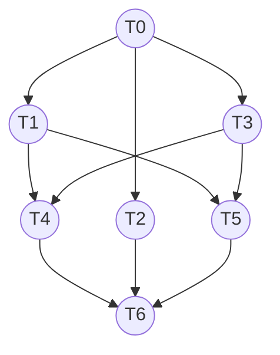
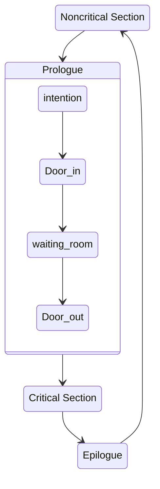

# PCO 2022-23 — TE 1
**HEIG-VD — REDS (Institut Reconfigurable and Embedded Digital Systems)**  
**Chargé de cours :** Rick Wertenbroek  
**Date :** 17.11.22  
**Prénom, Nom :** ________________________________________

---

### Consignes générales
Ce test contient 16 pages (page de garde et cinq pages de brouillon inclus) pour 7 questions. Le nombre maximum de points possible est 32. La dernière question est une question bonus. Répondre aux questions dans l'espace disponible, au besoin les pages de brouillon peuvent être utilisées, si votre réponse se trouve sur une page de brouillon, le mentionner sous la question.

* Aucun matériel n'est autorisé, seul de quoi écrire.
* Écrire son nom et prénom sur chaque feuille.
* Merci de ne pas remplir le tableau sur cette page.
* Merci de ne pas utiliser la couleur rouge pour vos réponses.

| Question | Points | Score |
| :--- | :---: | :---: |
| **1** | 4 | |
| **2** | 4 | |
| **3** | 4 | |
| **4** | 6 | |
| **5** | 8 | |
| **6** | 6 | |
| **7** (Bonus) | 0 | |
| **Total :** | **32** | |

---

## Question 1 (4 points) — Général
Donner deux points communs et deux différences entre les fils d'exécution (*threads*) et les processus (*processes*).

**Points communs :**
1. 
2. 

**Différences :**
1. 
2. 

---

## Question 2 (4 points) — Section critique
Remplir les exemples suivants avec des sections critiques lorsqu'il est nécessaire de garantir l'exclusion mutuelle.

```cpp
extern void DebutSC(); /* équivalent d'un lock() sur mutex */
extern void FinSC();   /* équivalent d'un unlock() sur mutex */
```

### Exemple 1
```cpp
static int val;

void threadA() {
    int a;
    a = val;
}

void threadB() {
    int b;
    b = val;
    if (b == 42) {
        val = 9 * 6;
    } else {
        val--;
    }
}

void threadC() {
    int c;
    val++;
    c++;
}
```

### Exemple 2
```cpp
static double val;

void threadA() {
    double a;
    val = a;
}

void threadB() {
    double b;
    val = b;
}
```

---

## Question 3 (4 points) — Threads
Des threads doivent effectuer un travail en commun, représenté ici par la fonction `doSomeWork()` qui retourne `true` lorsque le travail est fini (un simple jet de dé est utilisé à fin illustrative). Ceci est analogue à ce qui a été réalisé lors du laboratoire 2, où différents threads se partageaient la tâche de détecter la primalité d'un nombre. Lorsqu'un thread réalise que le travail est terminé, il indique aux autres threads qu'il faut s'arrêter et termine.

Le code proposé est-il adéquat ? Si non, justifier votre réponse. *(Note : Le code compile).*

```cpp
#include <pcosynchro/pcothread.h>
#include <vector>
#include <cstdlib>

#define NUM_THREADS 24

std::vector<PcoThread*> threads(NUM_THREADS);

bool doSomeWork() {
    int diceRoll = rand() % 20 + 1;
    if (diceRoll == 20) {
        return true;
    } else {
        return false;
    }
}

void threadFunction() {
    while (true) {
        bool finished = doSomeWork();
        if (finished) {
            for (auto& t : threads) {
                t->requestStop();
            }
        }
        if (PcoThread::thisThread()->stopRequested()) {
            return;
        }
    }
}

int main() {
    for (auto& t : threads) {
        t = new PcoThread(threadFunction);
    }
    for (auto& t : threads) {
        t->join();
        delete t;
    }
    return 0;
}
```

**Réponse :**

---

## Question 4 (6 points) — Sémaphores
Soit le code suivant :

```cpp
#include <pcosynchro/pcothread.h>
#include <pcosynchro/pcosemaphore.h>
#include <memory> /* Pour std::unique_ptr<> */
#include <vector>
#include <cstdlib>

class Player {
public:
    Player(int id, int health, int mana)
        : id(id), health(health), mana(mana),
          thread(std::make_unique<PcoThread>(&Player::run, this)) {}

    enum class Action {attack, heal, leave, nothing};

    void attack(Player* player) {
        if (health <= 0) return;
        int damage = rand() % 12 + 1;
        player->health -= damage;
    }

    void heal(Player* target) {
        if (health <= 0) return;
        int heal = rand() % 6 + 1;
        target->health += heal;
        this->mana -= 10;
    }

    void run() {
        while (health > 0) {
            Player* target = get_target(); // Retourne la cible choisie
            Action action = get_action();  // Retourne l'action choisie

            switch (action) {
                case Action::attack: attack(target); break;
                case Action::heal:   heal(target); break;
                case Action::leave:  return;
                default: break;
            }
            PcoThread::usleep(1000000);
        }
    }

    int id;
    int health;
    int mana;
    std::unique_ptr<PcoThread> thread;
};

std::vector<std::unique_ptr<Player>> players;

int main() {
    for (int i = 0; i < 10; ++i) {
        players.push_back(std::make_unique<Player>(i, rand() % 100 + 50, rand() % 100 + 20));
    }

    for (auto& player : players) {
        player->thread->join();
    }

    return 0;
}
```

Le programme principal va créer des joueurs (`Players`) qui ont chacun un thread qui simule leur comportement (fonction `run()`). Ce thread est lancé par le constructeur de la classe `Player`. Les joueurs vont choisir une cible (qui peut être eux-mêmes) et une action. Pour des raisons de simplicité seules deux actions sont données et le code pour le choix de la cible et de l'action est omis, on peut imaginer que ce soit fait dans une interface graphique avec un contrôleur. Le programme s'arrête lorsque tous les joueurs sont morts ou ont quitté (`leave`).

Ce code ne comporte aucun mécanisme de synchronisation ou d'exclusion mutuelle.
1. À vous de mettre en place le nécessaire pour garantir le bon fonctionnement du programme, il faut donc que l'état des joueurs ne soit pas corrompu.
2. On aimerait aussi que la fonction `run()` des joueurs attende que tous les joueurs soient créés par `main()` avant de continuer l'exécution.

Mettez ceci en place à l'aide de `PcoSemaphore` (car elles garantissent un ordre FIFO, premier arrivé premier servi). Vous pouvez ajouter du code (de la logique) au besoin. Attention aux interblocages.

**Rappel `PcoSemaphore` :**
```cpp
class PcoSemaphore {
public:
    /* Constructeur */
    PcoSemaphore(unsigned int n = 0);
    /* Acquire */
    void acquire();
    /* Release */
    void release();
};

/* Exemples */
PcoSemaphore sem(10);
PcoSemaphore mutex(1);
sem.acquire();
mutex.acquire(); /* lock */
mutex.release(); /* unlock */
sem.release();
```

---

## Question 5 (8 points) — Séquentialité
Dans le cadre de l'organisation d'une course d'orientation on aimerait faire partir les participants par groupes de 5 personnes. Le comportement des participants est simulé par des threads. Les participants vont appeler la méthode `depart()` qui va les faire patienter jusqu'à ce qu'ils puissent partir en groupe de 5 (donc lorsque 5 threads ont appelé `depart()`). La fonction `depart()` retourne le numéro de groupe qui leur est attribué : groupe 1 (les 5 premiers), groupe 2 (les 5 suivants), etc.  
*Note : Pour des raisons de simplicité on va supposer que le nombre de participants est un multiple de 5.*

Implémentez la fonction `depart()` avec des `PcoSemaphore`.

```cpp
int depart() {

}
```

---

## Question 6 (6 points) — Séquentialité
Soit le graphe d'exécution des tâches suivant :



**Rappel `PcoSemaphore` :**
```cpp
class PcoSemaphore {
public:
    /* Constructeur */
    PcoSemaphore(unsigned int n = 0);
    /* Acquire */
    void acquire();
    /* Release */
    void release();
};

/* Exemples */
PcoSemaphore sem(10);
sem.acquire();
sem.release();
```

Écrire un programme permettant de garantir ce fonctionnement, en utilisant des `PcoSemaphore`.

```cpp
#include <pcosynchro/pcothread.h>
#include <pcosynchro/pcosemaphore.h>
#include <vector>
#include <memory>

/* Prototypes des fonctions à écrire */
void t0();
void t1();
void t2();
void t3();
void t4();
void t5();
void t6();

std::vector<std::unique_ptr<PcoThread>> threads(7);

int main() {
    threads[0] = std::make_unique<PcoThread>(t0);
    threads[1] = std::make_unique<PcoThread>(t1);
    threads[2] = std::make_unique<PcoThread>(t2);
    threads[3] = std::make_unique<PcoThread>(t3);
    threads[4] = std::make_unique<PcoThread>(t4);
    threads[5] = std::make_unique<PcoThread>(t5);
    threads[6] = std::make_unique<PcoThread>(t6);

    for (auto& t : threads) {
        t->join();
    }
}
```

---

## Question 7 (6 points (bonus)) — Attente active
Lors du cours nous avons vu de nombreuses tentatives pour résoudre le problème d'exclusion mutuelle par attente active. En voici une de plus, elle est basée sur le schéma suivant (on considère qu'on a un processeur mono-cœur) :



```cpp
enum class states_c {non_critical, intention, door_in, waiting_room, door_out};
states_c state[2] = {non_critical, non_critical};
```

| `threadA()` | `threadB()` |
| :--- | :--- |
| <pre>void threadA() {<br>  while (true) {<br>    /* Prologue */<br>    state[0] = intention;<br>    while (state[1] == door_in<br>        \|\| state[1] == door_out);<br>    state[0] = door_in;<br>    if (state[1] == intention) {<br>      state[0] = waiting_room;<br>      while (state[1] != door_out);<br>    }<br>    state[0] = door_out;<br><br><br>    /* Section critique */<br><br>    /* Epilogue */<br>    while (state[1] == waiting_room);<br>    state[0] = non_critical;<br>  }<br>}</pre> | <pre>void threadB() {<br>  while (true) {<br>    /* Prologue */<br>    state[1] = intention;<br>    while (state[0] == door_in<br>        \|\| state[0] == door_out);<br>    state[1] = door_in;<br>    if (state[0] == intention) {<br>      state[1] = waiting_room;<br>      while (state[0] != door_out);<br>    }<br>    state[1] = door_out;<br>    while (state[0] != non_critical<br>        && state[0] != intention);<br>    /* Section critique */<br><br>    /* Epilogue */<br><br>    state[1] = non_critical;<br>  }<br>}</pre> |

**La solution proposée garantit-elle l'exclusion mutuelle ?**  
- [ ] Oui  
- [ ] Non  

**Justification :**