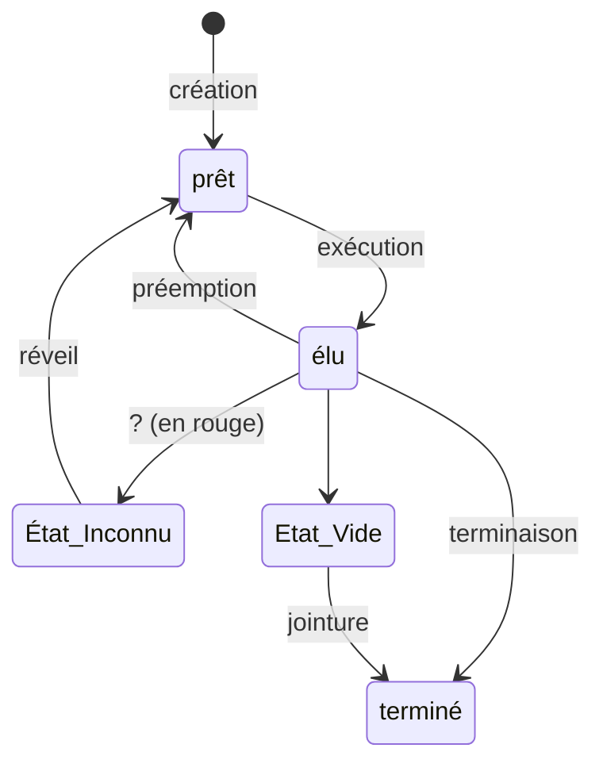

# PCO 2024-25 — TE 1

**Institution :** HEIG-VD — REDS (Institut Reconfigurable and Embedded Digital Systems)  
**Chargé de cours :** Florian Vaussard  
**Date :** 13.11.2024  
**Prénom, Nom :** ___________________________  

## Consignes générales

Ce test contient 22 pages (page de garde et quatre pages de brouillon inclus) pour 5 questions. Le nombre maximum de points possible est 35. Répondre aux questions dans l'espace disponible, au besoin les pages de brouillon peuvent être utilisées.

* Écrire son nom et prénom sur chaque feuille
* Utiliser de préférence un stylo
* Si votre réponse se trouve sur une page de brouillon, mentionnez-le sous la question
* Ne pas utiliser de couleur rouge
* Aucune documentation ni appareil électronique n'est permis

| Question | Points | Score |
| :--- | :---: | :---: |
| **1** | 8 | |
| **2** | 4 | |
| **3** | 6 | |
| **4** | 7 | |
| **5** | 10 | |
| **Total :** | **35** | |

---

## Documentation / Rappels

### Rappel sur la classe `PcoThread`
* `PcoThread::PcoThread(func, n1, n2, ...)`: crée un thread qui exécutera la fonction `func` en lui passant les arguments `n1`, `n2`, etc.
* `PcoThread::join()`: attend la terminaison d'un thread (bloquant)
* `PcoThread::requestStop()`: demande à un thread de se terminer
* `PcoThread::stopRequested()`: teste si on a demandé à un thread de se terminer
* `PcoThread::thisThread()`: renvoie un pointeur sur la classe `PcoThread` du thread courant

### Rappel sur la classe `PcoMutex`
* `PcoMutex::PcoMutex(recursionMode)`: crée un mutex (non-récursif par défaut)
* `PcoMutex::lock()`: verrouille un mutex
* `PcoMutex::unlock()`: déverrouille un mutex

### Rappel sur la classe `PcoSemaphore`
* `PcoSemaphore::PcoSemaphore(n)`: crée un sémaphore initialisé à $n$ ($n \ge 0$; $0$ par défaut)
* `PcoSemaphore::acquire()`: décrémente un sémaphore
* `PcoSemaphore::release()`: incrémente un sémaphore

---

## 1. Culture générale (8 points)

Répondez aux questions à choix multiple suivantes (1 seul choix possible).

**(a) Chaque thread d'un processus possède :**
- [ ] Son propre espace d'adressage
- [ ] Un espace d'adressage partagé entre tous les threads d'un même processus
- [ ] Un espace d'adressage partagé entre tous les threads du système
- [ ] Cela dépend du système d'exploitation
- [ ] Aucune de ces réponses

**(b) Sur un processeur monocœur, combien de threads s'exécutent simultanément dans l'état élu (*running*) ?**
- [ ] Au minimum 0 au maximum 1
- [ ] Au minimum 0 au maximum 2
- [ ] Toujours autant de threads qu'il en existe sur le système
- [ ] Aucune de ces réponses
- [ ] On ne peut pas savoir

**(c) Soit le diagramme d'états et de transitions d'un thread vu pendant le cours :**


*(Note pour l'agent : le diagramme original comporte les états `prêt`, `élu (running)`, `terminé`, un cercle vide en bas à droite menant à `terminé` via `jointure`, et un cercle rouge en haut à droite atteint depuis `élu` par une flèche rouge marquée `?` et retournant vers `prêt` par `réveil`.)*

Quelle transition et quel état figurent en rouge sur la figure :
- [ ] attente $\rightarrow$ bloqué (*waiting*)
- [ ] attente $\rightarrow$ zombie
- [ ] terminaison $\rightarrow$ zombie
- [ ] terminaison $\rightarrow$ bloqué (*waiting*)
- [ ] Aucune de ces réponses

Citez deux exemples concrets de situations menant un thread dans cet état :
1. __________________________________________________________________
2. __________________________________________________________________

**(d) En programmation concurrente, à quel problème se réfère-t-on quand on parle d'un interblocage ?**
- [ ] Une situation où un thread ne peut pas accéder à la section critique car les autres threads monopolisent l'accès à cette section
- [ ] Une erreur de programmation qui provoque une faute de segmentation
- [ ] Une situation où plusieurs threads ne peuvent plus progresser dans leur exécution car ils attendent sur une condition qui est devenue impossible à satisfaire
- [ ] Un problème d'accès à une ressource à cause de permissions insuffisantes
- [ ] Aucune de ces réponses

**(e) Quelle est l'utilité de déclarer un sémaphore `PcoSemaphore sem(-1)` ?**
- [ ] Cela permet d'effectuer un appel à `sem.acquire()` directement depuis le constructeur
- [ ] Cela permet de bloquer le thread à l'initialisation du sémaphore
- [ ] Cela permet d'ouvrir un portail spatio-temporel
- [ ] Aucune utilité, car cela initialisera le sémaphore à une valeur très élevée à cause de l'underflow d'un nombre non-signé
- [ ] Aucune de ces réponses

**(f) Quelle est l'utilité de déclarer un sémaphore `PcoSemaphore sem(3)` ?**
- [ ] Cela permet de protéger une section critique en l'entourant avec `sem.acquire()` et `sem.release()`
- [ ] Cela permet de protéger une section contrôlée en l'entourant avec `sem.acquire()` et `sem.release()`
- [ ] Cela permet d'ouvrir un portail spatio-temporel
- [ ] Aucune utilité, car les sémaphores doivent être initialisés avec des valeurs inférieures à 2
- [ ] Aucune de ces réponses

**(g) Soit le code suivant :**

```cpp
PcoSemaphore sem(1);

void taskA() {
    // instructions a1
    sem.acquire();
    // instructions a2
}

void taskB() {
    // instructions b1
    sem.release();
    // instructions b2
}
```

Que peut-on dire par rapport à l'exécution des instructions `a1`, `a2`, `b1` et `b2` une fois les threads `taskA` et `taskB` terminés ?
- [ ] Les instructions `a1` sont toujours exécutées après `b2`
- [ ] Les instructions `b2` sont toujours exécutées après `a1`
- [ ] Les instructions `b1` sont toujours exécutées après `a1`
- [ ] Il y a un interblocage
- [ ] Aucune de ces réponses

**(h) Le code suivant fournit une solution au problème du rendez-vous :**

```cpp
PcoSemaphore arriveA(0);
PcoSemaphore arriveB(0);

void taskA() {
    // instructions a1
    arriveB.acquire();
    arriveA.release();
    // instructions a2
}

void taskB() {
    // instructions b1
    arriveA.acquire();
    arriveB.release();
    // instructions b2
}
```

Que peut-on en dire ?
- [ ] Les instructions `a2` seront toujours exécutées après `b1`
- [ ] Dans certains cas, les instructions `a2` pourraient s'exécuter avant `b1`
- [ ] Le résultat dépend de l'ordonnanceur et donc du système d'exploitation
- [ ] Il y a un interblocage
- [ ] Aucune de ces réponses

---

## 2. Exclusion mutuelle (4 points)

Le code suivant fournit une solution au problème de l'exclusion mutuelle par attente active :

```cpp
bool intention[2] = {false, false};
int tour = 0; // ou 1

void T0()
{
    while (true) {
        if (intention[1]) {
            tour = 1;
        }
        intention[0] = true;
        while (tour == 1 && intention[1])
            ;

        // -> section critique ici <-

        intention[0] = false;
        // section non-critique
    }
}

void T1()
{
    while (true) {
        if (intention[0]) {
            tour = 0;
        }
        intention[1] = true;
        while (tour == 0 && intention[0])
            ;

        // -> section critique ici <-

        intention[1] = false;
        // section non-critique
    }
}
```

**(a) Cette solution garantit-elle l'exclusion mutuelle dans la partie commentée `section critique`, ainsi que l'absence d'interblocage ?**
- [ ] Oui
- [ ] Non

**(b) Si oui, fournissez une justification détaillée. Si non :**
1. Quelle propriété n'est pas garantie ?
2. Fournissez un scénario détaillé (incluant les numéros de lignes) pour illustrer le problème.

---

## 3. Thread (6 points)

Cortex, le savant fou, veut conquérir le monde ! Pour cela, il a besoin de nombres premiers. Il demande à Minus, son assistant, de concevoir un programme permettant de déterminer si un nombre est premier ou pas. Si un nombre n'est pas premier, le programme doit s'arrêter le plus rapidement possible.

Minus tente de réaliser un programme multithreadé afin d'accomplir sa tâche (voir code ci-dessous). Ce programme prend comme arguments le nombre à tester ainsi que le nombre de threads à utiliser. Voici un exemple d'utilisation :

```bash
$ ./q3 2147483647 12
2147483647 est premier
$ ./q3 2147483645 12
2147483645 n'est pas premier :-/
```

Malheureusement, Minus n'a pas eu la chance de suivre le cours PCO. Le plan machiavélique de Cortex va-t-il encore échouer ? Aidez-les en trouvant toutes les erreurs dans ce code. Pour chaque erreur, détaillez :
* à quelle ligne se situe le problème
* ce qu'il risque d'arriver et pourquoi
* comment le résoudre (n'hésitez pas à modifier directement le code)

*Note : l'algorithme pour la détermination d'un nombre premier est correct, même s'il est sous-optimal car il suffirait de tester jusqu'à $\sqrt{\text{nombre}}$. Ceci n'est pas un problème pour cet exercice.*

```cpp
#include <iostream>
#include <vector>
#include <pcosynchro/pcothread.h>

static std::vector<PcoThread*> threads;
static bool prime;

static void stop_threads()
{
    for (auto t : threads) {
        t->requestStop();
    }
}

static void should_stop()
{
    if (PcoThread::thisThread()->stopRequested()) {
        std::cout << "Arrêt du thread" << std::endl;
        return;
    }
}

static void is_prime(uint64_t number, uint64_t first, uint64_t last)
{
    for (uint64_t i = first; i <= last; i++) {
        if (number % i == 0) {
            // pas un nombre premier -> stop tous les threads
            prime = false;
            stop_threads();
        }

        if (i % 100 == 0) {
            // stop si demandé par un autre thread
            should_stop();
        }
    }
}

int main(int argc, char* argv[])
{
    unsigned int num_threads;
    uint64_t number;
    uint64_t interval;
    uint64_t first;
    uint64_t last;

    if (argc != 3) {
        return 1;
    }

    number = std::strtoull(argv[1], NULL, 10);
    num_threads = std::strtoul(argv[2], NULL, 10);
    interval = number / num_threads;

    // test tous les diviseurs de 2 à N-1 (simple mais pas optimal...)
    threads.resize(num_threads);
    prime = true;
    first = 2;
    for (unsigned int i = 0; i < num_threads; i++) {
        last = first + interval - 1;
        if (last > number - 1) {
            last = number - 1;
        }
        threads[i] = new PcoThread(is_prime, number, first, last);
        first += interval;
    }

    if (prime) {
        std::cout << number << " est premier" << std::endl;
    } else {
        std::cout << number << " n'est pas premier :-/" << std::endl;
    }

    for (unsigned int i = 0; i < num_threads; i++) {
        delete threads[i];
    }

    return 0;
}
```

---

## 4. Mutex (7 points)

Le code ci-dessous fournit l'implémentation fonctionnelle d'une liste chainée permettant de stocker un entier.

Cette implémentation n'est cependant pas sûre du point de vue de la concurrence. Voici par exemple un programme qui utilise une liste partagée entre plusieurs threads où cela pourrait poser problème :

```cpp
static LinkedList list;

static void adder(int tid)
{
    list.push_front(tid);
}

static void print_list(LinkedList &list)
{
    int data;
    unsigned int i = 0;
    while (list.get(i, &data) == 0) {
        i++;
        cout << data << " ";
    }
    cout << endl;
}

int main()
{
    PcoThread* threads[2];

    // rempli la liste depuis plusieurs threads
    for (unsigned int i = 0; i < 2; i++) {
        threads[i] = new PcoThread(adder, i);
    }

    for (unsigned int i = 0; i < 2; i++) {
        threads[i]->join();
        delete threads[i];
    }

    // affiche et vide la liste
    print_list(list); // affiche par exemple "1 0"
    list.pop_front();
    print_list(list); // affiche par exemple "0"
    list.pop_front();
    print_list(list); // affiche par exemple ""

    return 0;
}
```

Modifiez l'implémentation de cette liste chainée en ajoutant le verrouillage nécessaire à une implémentation sûre au moyen de `PcoMutex`.

```cpp
class Node {
protected:
    int data;
    Node* next;

public:
    Node(int data) : data(data), next(NULL)
    {
    }
};

class LinkedList {
protected:
    Node* head;

public:
    LinkedList() : head(NULL)
    {
    }

    void push_front(int data)
    {
        // crée le nouveau noeud
        Node *newNode = new Node(data);

        // liste vide, assigne à head
        if (head == NULL) {
            head = newNode;
            return;
        }

        // insère le nouveau noeud
        newNode->next = this->head;
        this->head = newNode;
    }

    void pop_front()
    {
        Node* temp = head;

        if (head == NULL) {
            // déjà vide
            return;
        }

        head = temp->next;
        delete temp;
    }

    int get(unsigned int index, int* data)
    {
        Node* next = head;
        unsigned int i = 0;

        // itère sur tous les noeuds
        while (next != NULL) {
            if (i == index) {
                *data = next->data;
                return 0;
            }
            next = next->next;
            i++;
        }
        return -1;
    }
};
```

---

## 5. Sémaphore (10 points)

Nous souhaitons réaliser une classe `PontLevant` pour modéliser l'accès à un pont levant, dont voici le fonctionnement :
* La méthode `arrive()` est appelée par les threads qui souhaitent accéder au pont. Si le pont est accessible (donc abaissé), les threads peuvent directement sortir de la méthode. Dans le cas contraire, ils doivent attendre que le pont change d'état.
* La méthode `abaisse()` permet d'activer l'accès au pont. Les threads qui seraient en attente dans `arrive()` doivent également être relâchés. Appeler plusieurs fois cette méthode n'a pas d'autres effets.
* La méthode `releve()` permet de bloquer l'accès au pont. Appeler plusieurs fois cette méthode n'a pas d'autres effets.

Implémentez la classe `PontLevant` selon ce cahier des charges au moyen de `PcoSemaphore`. Une ébauche de la classe vous est fournie ci-dessous.

```cpp
class PontLevant
{
private:

public:
    PontLevant()
    {
    }

    ~PontLevant()
    {
    }

    void arrive()
    {
    }

    void abaisse()
    {
    }

    void releve()
    {
    }
};
```